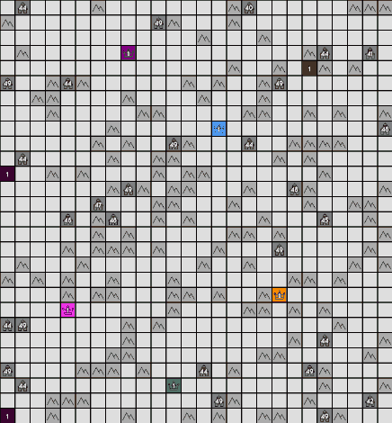
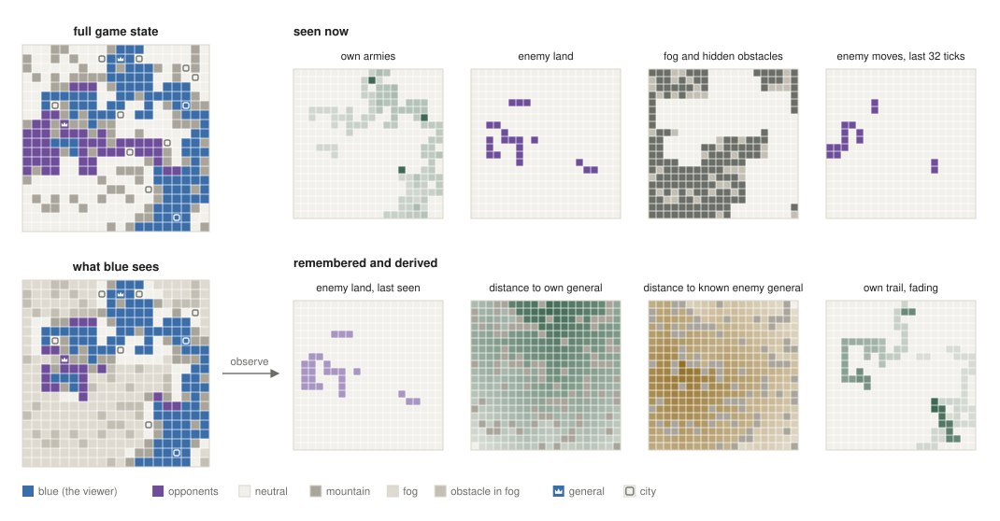
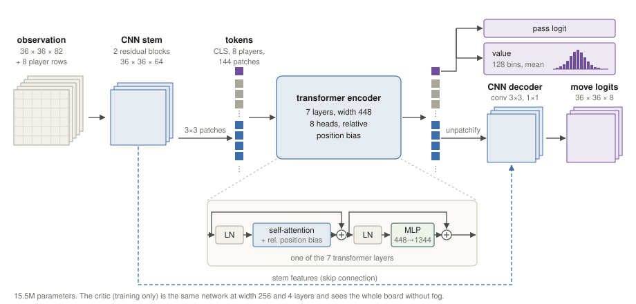

<div align="center">

<h1>Macbeth</h1>

<p><b>A <a href="https://generals.io">generals.io</a> free-for-all bot: behavior cloning first, then self-play reinforcement learning.</b></p>

<p>


</p>



<p><a href="https://generals.io/replays/KH3VDZpt1">First win against human players</a></p>

</div>

## What we did

We trained a neural network to play 8-player FFA on generals.io in two steps: behavior cloning (BC) to get a
reasonable starting policy, then reinforcement learning (RL) by self-play to go beyond it. RL from scratch with eight
players spends a long time moving at random before it learns even to expand, so it pays to start from a policy that
already plays sensibly.

1. **Behavior cloning.** We cloned [Human.exe](https://github.com/EklipZgit/generals-bot), the strongest FFA bot, from
   about 1,900 of its games. The clone is far weaker than the original: Human.exe is a large hand-written program
   that plans many turns ahead, and from the board alone the clone can only guess those plans. It copies the
   opening, expanding and gathering, but rarely knows where to strike next.
2. **Reinforcement learning by self-play.** Starting from the clone, the network plays millions of games against
   copies and older versions of itself and learns from the rewards it gets. The recipe follows Average Joe, the
   superhuman 1v1 agent of Straka, Lisý & Schmid [[1]](#references), adapted to eight players.

After about 9 hours of self-play on one H100 (8 players, fair share of wins 12.5 %):

| | vs 7 Expander bots | vs 7 Harvester bots |
|---|---|---|
| clone of Human.exe (imitation only) | 0 % wins | 6 % wins |
| after self-play | 75 % wins | 59 % wins |

Self-play makes it much stronger than the clone, but it is still clearly weaker than Human.exe itself: a midway
checkpoint, alone against three Human.exe, won 1 of 8 games (the fair share would be 2).

## How it works

- **Simulator.** Games run on the GPU in JAX ([generals-bots](https://github.com/strakam/generals-bots)), thousands
  of moves per second. Maps are made to look like real FFA maps: sizes, spawns and cities follow real games.
- **Reward.** Winning, a bonus for every general taken and a small shaping term (see [Reward](#reward)).
- **Training tricks.** A separate critic that sees the whole board (training only), a pool of frozen older versions
  as opponents, and a pull towards the clone's moves that fades out over the first hours.

## What the network sees

Only what a human player would see. Every board is padded to 36x36 and turned into 82 feature planes, plus one row
per player from the public scoreboard:

- **The board under fog of war:** own, enemy and neutral cells with their armies, cities, mountains, which
  opponent owns what.
- **The last 32 ticks:** own moves and the enemy moves it could see.
- **Memory:** what it saw earlier and can no longer see, such as enemy generals, each opponent's land when last
  seen and enemy armies with how long ago.
- **Helpers:** walking distances to its own general, to each known enemy general and to its own land, and a fading
  trail of its own moves.
- **Scoreboard:** land and army of every player and how they changed over the last 1 to 512 ticks.

<p align="center"></p>

*A 4-player game at tick 230: the full board, what the blue player sees of it, and 8 of the 82 planes computed from that view.*

## Network

<p align="center"></p>

The board is cut into 3x3 patches, so a 36x36 board becomes 144 tokens, plus one token per player and one for the
whole game. A small CNN before the transformer lets every cell see its neighbours, and one after it turns the
patch outputs back into a move per cell. Attention knows how far apart two patches are (relative position bias),
so the same pattern means the same thing anywhere on the board and on every map size.

## Reward

In FFA only the win counts, so that is the main reward. On its own it is a weak signal: games last about 1,000
ticks, and against equal opponents a policy wins only one game in eight. Two extra terms help it learn faster.

| | reward | why |
|---|---|---|
| win | +0.5 | the goal: the last player standing |
| any other end | -0.15 | out, or still alive when the game is cut off at 1,500 ticks. Surviving without winning is worth nothing, so hiding does not pay |
| each general taken | rises with every capture: the 7th pays 7 times the 1st, all 7 together +0.45 | a captured general hands over its land and armies, so the first capture makes the next one easier (snowballing). Rewarding captures more and more pushes the policy to use its lead instead of sitting on it |
| shaping | change of the material advantage | feedback long before the game ends (below) |

**Shaping.** The material advantage is the player's land, army and cities compared to the other players' average,
as in Straka & Schmid [[2]](#references).
The policy gets rewarded for every increase and pays for every decrease. Over a whole game these terms add up to
zero, so they cannot change what the best play is. They only tell the policy earlier whether a move was good,
instead of 1,000 ticks later. We read the advantage only on the ticks where every cell grows by one (every 50
ticks). Read every tick, the shaping paid for leaving the general at once with tiny armies, which most likely cost the
policy the patient opening it had copied from Human.exe. On the bonus ticks it pays for what a player actually holds when it
counts, which also rewards taking enemy land right before the bonus, as good players do.

## Setup

Training needs Linux with an NVIDIA GPU (CUDA 12). Watching, evaluating and online play also run on the CPU.

```bash
uv sync --extra cuda      # with a GPU, plain `uv sync` without one
```

`uv sync` also installs the JAX simulator [generals-bots](https://github.com/strakam/generals-bots), pinned to one
commit, into the project's environment. Human.exe is only needed to play against it: `scripts/setup_humanexe.sh`
clones it into `third_party/` (not part of this repository) with its own Python 3.14 environment.

## Training

```bash
configs/data.sh                 # download Human.exe's replays and prepare them (run regularly: replays expire)
configs/clone.sh                # imitation, about 1 hour on a 16 GB GPU
configs/selfplay_local.sh       # self-play on a local GPU
configs/selfplay_modal.sh 6     # ... or 6 hours on a Modal H100 (about $24), keeps running if you log off
```

Self-play runs resume where they stopped. For Modal, run `uv run modal setup` once and fetch results with
`uv run modal volume get generals-rl /runs/selfplay runs/`.

## Watch, evaluate, play online

```bash
uv run scripts/watch.py         # watch a checkpoint play in the browser: http://localhost:8051
uv run scripts/eval_bots.py --policy runs/selfplay:latest --bots expander harvester
scripts/setup_humanexe.sh       # once, then: uv run scripts/eval_humanexe.py --run runs/selfplay
uv run scripts/play_online.py --run runs/selfplay --user-id "$GENERALS_USER_ID" --ffa --games 3
```

`play_online.py` joins the public FFA queue. The user id is any secret string. Register a name for it once with
`--username`. The terminal shows the scoreboard and the generals taken, http://localhost:8052 the game itself.

## Limitations

- **Compute.** Average Joe [[1]](#references) trained for 672 GPU hours, we had about 10. Progress slows down roughly with the log
  of the compute, so more time would help, but slowly.
- **Small batches.** Storing every player's observation limits a run to 64 games at a time even on an 80 GB GPU,
  so each iteration learns from only about 6,000 moves.
- **Cloning has a ceiling.** The clone predicts about half of Human.exe's moves, but only one in eight of the moves
  that start a new plan. Human.exe decides those from internal plans the board does not show, so a longer history
  did not help.
- **Not yet better than Human.exe**, and only lightly tested against humans.

## Credits

Simulator and replay decoder: Matej Straka and colleagues ([generals-bots](https://github.com/strakam/generals-bots),
MIT). Human.exe: EklipZ ([generals-bot](https://github.com/EklipZgit/generals-bot), MIT).

## References

1. Matej Straka, Viliam Lisý, Martin Schmid. *Superhuman AI for Generals.io Using Self-Play Reinforcement Learning.*
   2026. [arXiv:2606.23348](https://arxiv.org/abs/2606.23348)
2. Matej Straka, Martin Schmid. *Artificial Generals Intelligence: Mastering Generals.io with Reinforcement
   Learning.* 2025. [arXiv:2507.06825](https://arxiv.org/abs/2507.06825)
